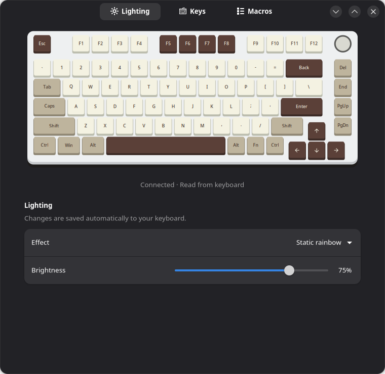
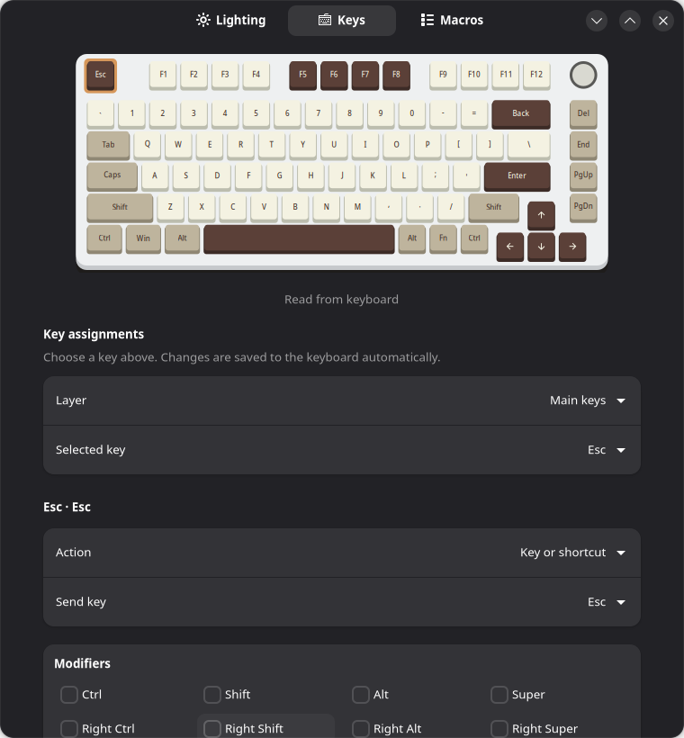
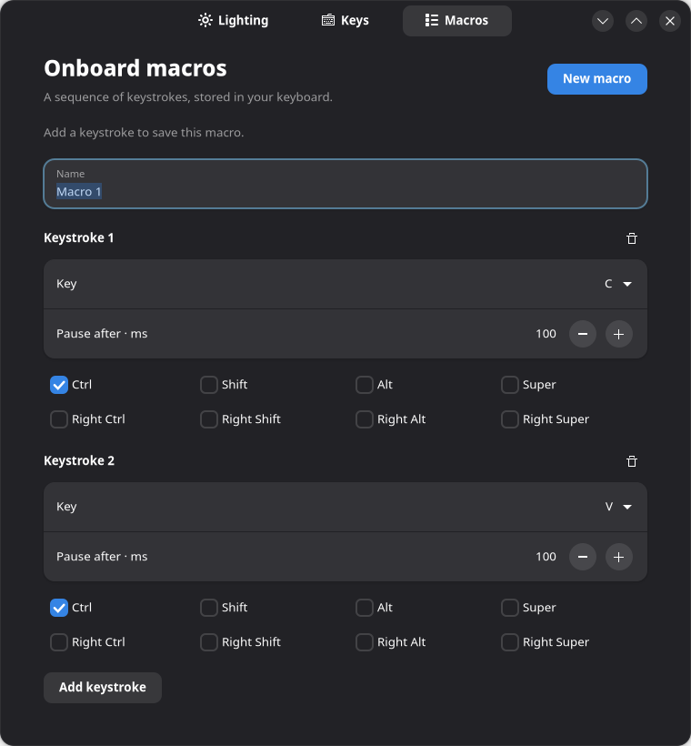

# HI75 Studio

A GTK 4 / libadwaita app for the **original Leobog HI75 V5 firmware**, tested with USB `258a:010c`, revision `0500` and the verified interface 01 descriptor. No firmware replacement is required.



- Automatic keyboard discovery and configuration readback.
- Solid color picker, hex input, brightness, and native lighting effects.
- Main and Fn key remapping, keyboard shortcuts, media actions and onboard macros.
- Automatic saving, verified writes and configuration backups.

## Install on Fedora

```sh
sudo dnf install git python3-gobject python3-cairo gtk4 libadwaita polkit desktop-file-utils
git clone https://github.com/scanash00/hi75-studio.git
cd hi75-studio
python3 hi75_gtk.py --demo  # preview without hardware access
pkexec /usr/bin/python3 install.py
```

Open **HI75 Studio** from the application menu. Installation requires administrator authentication once. A restricted PolicyKit rule allows the installing user's active local session to use the root-owned helper without repeated password prompts. The GUI runs unprivileged.

## Lighting and persistence

Native effects, brightness, speed and palette are read from the keyboard. Native effect changes use the stock firmware's configuration save path. Effect names describe behavior inferred from the firmware; timing and direction have not all been physically calibrated. See [effect research](research/effect-names.md).

**Custom Solid is host-driven.** Its color and brightness are saved on this computer and a background service refreshes the RGB frame every 80 ms while it is active. Closing the window leaves that stream running. The installer **does not enable the service at startup**. Custom Solid is not an onboard color save and will not automatically return after a reboot. Choosing a native effect stops streaming and clears the host override.

The app polls the actual configuration every three seconds. Saved Solid color is identified separately from keyboard readback: the stock protocol does not expose LED framebuffer RGB. Hardware configuration changes supersede the saved override. The keyboard illustration depicts layout and selected color, not measured LED output.

## Keys and macros



The Keys tab reads the main and Fn tables. Select a key, then choose a key/shortcut, media action or macro. Changes save automatically. Fn and the knob are protected; alternate OS tables are preserved. Original main and Fn assignments can be restored individually.



The Macros tab supports named sequences of up to 64 keystrokes with modifiers and pauses of 1–32,767 ms, subject to available keyboard memory. Each keystroke is released automatically, and assigned macros run once per press. Macros live on the keyboard and are read back when the editor opens. Unsupported existing formats are preserved. Referenced macros must be unassigned before deletion.

Writes are backed up, checked against a fresh baseline and verified. Macro payloads are written before their directory is committed. Failed or uncertain writes are not blindly retried; a fresh read is required. Cold power-cycle retention has not been separately measured, although these pages use the firmware's flash write path.

## Files and troubleshooting

- GUI: `/usr/local/share/hi75-studio`
- Root-owned helper: `/usr/local/lib/hi75-studio`, `/usr/local/bin/hi75-studio-control`
- Saved host Solid profile: `/var/lib/hi75-studio/solid.json`
- Configuration backups: `/var/lib/hi75-studio/backups`
- Optional running Solid stream: `hi75-studio-rgb.service`

Do not run another keyboard configuration tool concurrently. Access is restricted to the tested device descriptor; other HI75 revisions are not claimed compatible. This is an independent project, unaffiliated with Leobog.

To revoke password-free access, remove `/etc/polkit-1/rules.d/49-hi75-studio.rules`.

## Development and validation

Python 3, PyGObject, Pycairo, GTK 4 and libadwaita are required.

```sh
python3 -m unittest discover -s tests -v
python3 hi75_gtk.py --demo
```

All 36 tests passed during publication preparation, including GUI tests in a graphical session. Hardware access is mocked. Prior physical checks covered remap and macro write/read/restore, plus an F12-triggered F13 press/release. Original keymap and macro data were restored after those checks. See [protocol research](research/stock-capabilities/README.md); historical source paths there describe evidence not bundled in this repository.

## License

GPL-2.0-or-later. See [LICENSE](LICENSE) and [NOTICE.md](NOTICE.md). For the separate experimental SMK firmware port, see [hi75-smk](https://github.com/scanash00/hi75-smk).
